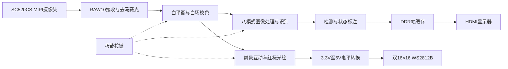

# FPGA 实时视觉处理与交互灯墙

基于 **安路 HX1P35A / PH1P35MDG324 -3**、SC520CS MIPI 摄像头与双 WS2812B 灯板的实时视频工程。图像经过 FPGA 处理，以 **1280×720 HDMI** 输出，并支持目标识别驱动的光绘与前景互动。

冻结版本：`sc520_cal_final_2026-11-01`。本仓库为私有工程，保留原始源码、厂商 IP、约束、40 套历史仿真检查与便携 SRAM 下载工具。

## 快速开始

| 目的 | 入口 |
|---|---|
| 先检查下载包，无需接板 | 根目录 `02_validate_only.cmd` |
| 检查 USB/JTAG 接口 | 根目录 `03_check_connection.cmd` |
| 将冻结固件下载到 SRAM | 根目录 `01_download_sram.cmd` |
| 检查源码、固件与历史证据完整性 | `python tools/verify_repository.py` |
| 打开 TD 工程 | [camera_to_dsi_display.al](engineering/candidates/sc520_cal_final_2026-11-01/candidate/sc520_shapes/td_project/camera_to_dsi_display.al) |
| 使用全部功能和按键 | [01_全部功能与按键.md](01_全部功能与按键.md) |
| 重新编译与仿真 | [docs/BUILD_AND_SIMULATION.md](docs/BUILD_AND_SIMULATION.md) |

建议 Windows 用户将整个仓库克隆到较短的英文路径，例如 `C:/f/fpga-sram-demo`。仓库保留 `* -text` Git 属性，避免换行转换破坏交接文件哈希。

展示下载需要 Windows 10/11 x64、Windows PowerShell 5.1、已配置的 FTDI 接口驱动及实际连接的开发板。TD 和 ModelSim 用于重新编译/仿真；使用冻结 SVF 展示下载无需先安装 TD。

**固件只下载到 SRAM，断电不保留。** 本包没有 Flash 固化命令；白场校色系数在复位、断电或重新下载后也需重新采集。启动默认边缘模式、灯墙默认关闭。

## 功能

| 部分 | 已接入的工程功能 |
|---|---|
| 八种图像模式 | 彩色原图、灰度、二值化、Prewitt 边缘、三档增强、颜色形状识别、运动检测、卡通化 |
| 图像预处理 | 自动白平衡、按键触发白场标定与空间色彩补偿、中间调提亮、温和降噪 |
| 目标与标注 | 红/黄/绿/蓝颜色分割、圆/三角/矩形/未知分类、最多 4 个显示目标、检测框及中心坐标 |
| 运动与状态 | 主要变化区域框、运动量、内部处理延时及运行状态、安路 Logo 与中文 OSD |
| 双灯板 | 两块 16×16 串接，组成 32×16 灯墙，流光/绘画/定格/彩虹涟漪四状态 |
| 六色光绘 | 红色标记物定位、青/蓝/紫/红/橙/绿笔色、抬笔落笔、清屏、定格 |

识别采用颜色分割、连通域及几何特征，适合大号、哑光、相互分离的纯色目标；正方形归入矩形，无法可靠分类时保留未知。运动量不是物理速度，内部延时也不包含完整的传感器曝光和显示器响应。

## 数据流



## 常用按键

| 操作 | 效果 |
|---|---|
| 短按 K1 | 循环八种图像模式 |
| 短按 K2 | 回彩色原图 |
| K1+K2 同时约 2 秒，全部松开 | 以满视场均匀白纸为参考，采白标定；成功后显示 ON |
| 单独长按 K3 约 2 秒 | 任意图像模式下打开/关闭灯墙 |
| 二值/边缘/识别/卡通中短按 K3、K4 | 对应阈值增加、减少 |
| 增强中短按 K3、K4 | 增强升档、降档 |
| 原图且灯墙开时短按 K4 | 流光→绘画→定格→彩虹涟漪 |
| 绘画中短按 K3 | 落笔/抬笔 |
| 绘画中长按 K4 约 1 秒 | 换笔色并抬笔 |
| 绘画中 K3+K4 同时约 1 秒 | 清屏并抬笔 |

完整操作、采背景和校色失败处理见[功能与按键说明](01_全部功能与按键.md)。白纸标定与灯墙空场背景采集是两个不同步骤。红标光绘有效范围约为摄像画面 x=320～959、y=200～519，32×16 灯墙适合粗线条和简单符号。

## 硬件连接

摄像头接板载 MIPI，显示器接 HDMI。当前冻结工程灯墙输出为 **P5 / J1 第 15 脚**，经已验证通道从 3.3V 转为 5V 后接第一灯板 DIN，第一板 DOUT 接第二板 DIN。两板独立 5V 供电，与 FPGA 和转换模块共地。

详细供电与地线关系见[硬件接线与重编译](04_硬件接线与重编译.md)，接口驱动见[USB 故障排查](03_USB驱动与故障排查.md)。该引脚说明仅对应本冻结版本。

## 工程与验证材料

```text
engineering/candidates/sc520_cal_final_2026-11-01/
  candidate/sc520_shapes/   # RTL、厂商IP、引脚/时钟约束、TD工程
  sim/                     # Testbench、DO脚本和参考向量
  tools/                   # 原工程构建/时序/下载脚本，保留历史环境信息
  reports/                 # 冻结构建、仿真与检查证据
sram/                      # 固定bit、SRAM SVF与DONE检查
hardware/openocd/          # 便携下载程序、脚本及原始许可证
evidence/                  # 原交接包证据
test_cards/                # 浏览器颜色/形状图卡
tools/                     # 便携下载和仓库完整性验证
docs/                      # 复现说明与本次仓库核验
```

原工程工具：Anlogic TD **6.2.1 / 6.2.168116**，ModelSim Intel Starter **18.1** 或兼容环境。最终报告记录 Slice **20342/21216**、ERAM **90/108**、DSP **35/40**；Setup WNS **+0.004ns**、Hold WNS **+0.020ns**。这是交接版本的既有报告，不是本次 GitHub 整理重新构建的结果。

本次仓库核验：1165 项原清单、464 个展开源码文件、78 个 TD 文件引用、242 项构建输入哈希、360 项仿真输入哈希、40 份历史仿真日志均通过。详情见[仓库核验记录](docs/REPOSITORY_VERIFICATION.json)。原板历史记录为 SRAM 下载及 DONE 检查通过，`visual_accepted=false`；不能据此写成接收电脑已重新运行全部硬件测试。

固件 SHA256：

```text
f6a70cbb28952be264bc96c47d753bb9caf8edbc1e87d0f2ef8c4adc300dcaed
```

更多原始材料：[下载与展示](00_先读我_下载与展示.txt)、[拍摄流程](02_全功能拍摄流程.md)、[版本元数据](VERSION.json)、[导入核验](IMPORT_VERIFICATION.json)。`工程源码_可选.zip` 保留原字节，供清单及展开快照交叉核验。

## 第三方材料

厂商 IP、板卡例程和 OpenOCD 保留其原始声明及许可证，未将它们统一改授为 MIT 或其他开源许可。现阶段仓库保持私有，便于团队备份与协作。
